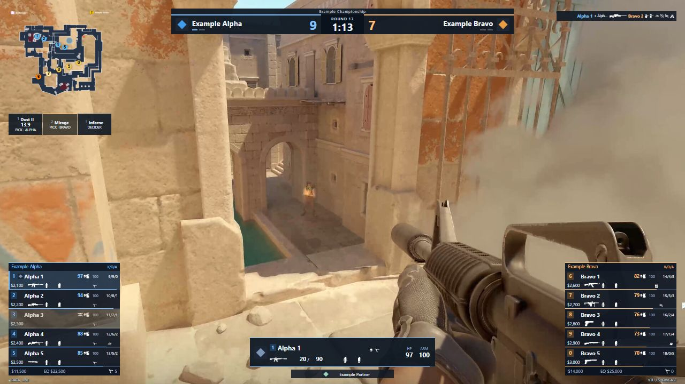

# sOU Broadcast HUD · React

A transparent CS2 broadcast HUD under GPLv3 and a practical reference
for authors using **React and the public sOU HUD SDK**. It includes a live overlay
and seven presentation views. Every display uses public protocol-v2 snapshots, optional
local profile metadata, or an explicit operator setting. It does not invent
players, match results, events or statistics.

Current HUD version: **0.4.6**. Package ID: `sou-basic-react`.



The example image uses the real packaged renderer with synthetic HUD data in an
isolated host over an unmodified [official CS2 reference screenshot from Steam](https://store.steampowered.com/app/730/CounterStrike_2/).
The Valve game image is only the test backdrop and is not included in the HUD.
This is a browser preview, not a native CS2/OBS capture. Synthetic previews
are excluded from production. Original Valve weapon/equipment silhouettes and
map artwork have separate copyright notices. Original Boltobserv radar assets,
calibration and marker behavior retain their upstream notices and map-specific
MIT exceptions. See [license scope](LICENSING.md), [Boltobserv provenance](licenses/BOLTOBSERV-NOTICE.md)
and [Valve artwork provenance](licenses/VALVE-ASSETS.md). The public sOU SDK remains MIT.

## Install and open an output

Download the `.souhud` file from [GitHub Releases](https://github.com/getsOU/sOU-HUD-React/releases/latest).
The adjacent `.sha256` identifies the exact archive. Ready-made packages require
no Node.js, .NET SDK, source checkout or separate web server.

1. Install [sOU](https://www.getsou.app/download), sign in with an enabled account,
   and select the workspace and active match you want to broadcast.
2. Open **HUDs → Paket importieren** and select the downloaded `.souhud`.
3. Select **sOU Broadcast · React** and open its output. Use the URL supplied by sOU in
   OBS or the native output. Do not open `index.html` as a local file.
4. Open the HUD panel. The **Display → Main output scene** selector controls the
   main output; leave it empty or choose **Live** for the game overlay. Dedicated
   subviews are described below.
5. Leave the **Hide…** checkboxes unchecked to display their components. Set text,
   optional images and featured references as needed, then save the panel.
6. Configure GSI in sOU, start CS2 and spectate the match. Use sOU's HLAE integration
   if you want its radar positions and killfeed. An observed-player card requires
   a real `observedPlayer`; selecting a featured player does not select a camera.

The composition is a 1920 × 1080 reference canvas, scaled uniformly into the
available viewport with transparent letterboxing. Use a 1920 × 1080 OBS browser
source. Keep the browser source transparent. Version 0.4.1 places normal live
information at the edges: two-line player cards, weapon/equipment icons, economy
inside each roster footer and a compact observer card. Detailed equipment,
round statistics and map cards remain in the presentation views. Missing live
portraits/logos use no replacement box. No remote fonts, CDNs or tracking load.

Players known to be dead have no current weapon, weapon name, ammunition or stale
inventory display. A living player with no active weapon likewise leaves the
current-weapon area empty; it does not acquire a question mark, unknown label,
ammunition placeholder or a holstered weapon. An explicitly empty inventory is
authoritative even when a contradictory old `activeWeapon` value is present.
Missing health does not imply death. A genuinely supplied unknown active/reloading
weapon remains a separate unknown-equipment case. See [changes](CHANGELOG.md).

Known maps, including **Dust2**, automatically select the bundled original **Boltobserv**
radar and calibration. Leave the optional radar override fields empty to use it. You do not need
to find an overview image or configure world bounds for a supported map.

An imported version has its own immutable files. Install a new version and open
an output for that version to update; an already running older output keeps its
original files. Existing 0.1.x, 0.2.x and 0.3.x packages/settings are not overwritten.

## Compact live composition

All coordinates below use the 1920 × 1080 reference canvas and scale together;
smaller 16:9 windows keep the same composition. These boxes also guide authors
customizing the layout.

| Element | Reference placement / maximum size |
| --- | --- |
| Match header | x480, y24 · 960 × 72 |
| Compact map series | x24, y320 · 288 × 42, equal ordered map cells |
| Round history during pauses | x720, y104 · 480 × 32, last twelve reported rounds |
| Radar | x24, y24 · 288 × 288 |
| CT / T rosters | x24 / x1584, y738 · 312 × 318 each, including five cards and economy footer |
| Player card | Two lines, at most 54 px high |
| Observed player | x700, y950 · 520 × 82 |
| Sponsors | x816, y1040 · 288 × 24 |
| Killfeed | x1560, y32 · at most 336 × 180 |

Preserve the game region x360–1560, y160–930 when customizing normal Live and keep
normal opaque surfaces within 25% of the canvas. An explicitly triggered lower
third can temporarily enter that area. Use Statistics or Spotlight for detailed
player data and the other dedicated views for match/series presentation, rather
than enlarging live panels over the game.

The center clock shows **ROUND 5** for a known current round, or an actual bomb,
defuse, timeout or pause state. No round is invented when its number is missing.
The caption is exactly the saved **Scoreboard caption**, otherwise the competition
name; an empty pair leaves the title area absent. The Live header has no raw map
ID, enum phase, concatenated league/season sections or floating best-of score strip.

Series wins are small pips below the correct team's name, only with a known valid
best-of and reliable team/side assignment. Side swaps move names, logos and wins
together. Map cells below the radar retain configured play order and show completed
results only when both scores are known. Results are always Team A : Team B; the
cell's accessible label/title names those teams. A current-map highlight requires
an exact match with the real game's map name. For example, a Dust2 game cannot
mark a configured Ancient/Inferno/Nuke series as currently playing Inferno merely
because that configured entry has a Live status.

Round history appears during Freeze, Pause, a team timeout or Intermission. It is
absent from the Live DOM during an active round, bomb/defuse and round over. The
last twelve actual numbered results show their original winning side and reason;
time expiry uses a clock and an unknown reason a neutral symbol. Statistics can
show the full reported history independently of the current game phase.

## Eight views

All views share the same renderer, SDK identity, current snapshot and panel.
There are no separate HTML builds or router dependencies.

| View | Relative output path | What it shows |
| --- | --- | --- |
| Live | `index.html` | Compact edge header, two-line rosters with economy footers, observed player, automatic map radar, real killfeed, small round/series indicators and production overlays. |
| Prematch | `views/prematch` | Active match before GSI, both managed teams, available logos, planned start/countdown, competition context and series. |
| Lineups | `views/lineups` | Actual matching team rosters and available local player portraits. Missing roster metadata stays unavailable rather than becoming a guessed five-player lineup. |
| Map veto | `views/veto` | Explicit picks, bans and decider, their recorded team assignments, play order and map results. |
| Break | `views/break` | Operator title/subtitle, competition branding, real planned-start countdown when available and match/series context. |
| Results | `views/postmatch` | Saved series and map results; a winner is stated only when the available rules and results determine one. |
| Statistics | `views/statistics` | Full player table: current K/D/A, MVP/score, round values, economy and recorded ADR/headshots with coverage. |
| Spotlight | `views/spotlight` | The selected player, team or match reference, available local images and matching live values; falls back to the actual observed player when appropriate. |

Open a dedicated subview through sOU's output selection. Relative paths above
are resolved beneath the installed package root, for example
`/hud-packages/sou-basic-react/0.4.6/views/veto`. Keep the sOU-generated address,
browser session and base path. Explicit subviews ignore the main scene selector;
changing **Main output scene** does not turn a dedicated statistics output into
another view.

## Components and data sources

| Component | Public source | Limits and missing-data behavior |
| --- | --- | --- |
| Match header and identities | `managedMatch` (also available before GSI), explicit CT/T assignments and `game.ct`/`game.t` | Team A/B are stable match identities, not permanent CT/T sides. Only matching IDs and recognized/inferred/manual assignments resolve managed side names. Unknown assignments stay explicit. |
| Player rosters | `game.players`, typed state, weapons and stats | Live keeps five two-line cards per side: observer digits, name, HP/armor, equipment/condition icons, active weapon, utility, money and K/D/A. Detailed inventory/ammo, equipment value and round statistics remain available in the detail views. Missing HP does not mean alive; zero remains zero. |
| Observed player | `game.observedPlayer` | Actual observed identity, HP/armor, active weapon/ammo and utility; no first-player fallback. Recorded ADR/HS and full equipment belong to expanded Spotlight. Optional portraits require a matching profile/reference; missing images consume no live placeholder space. |
| Round state/history | `roundNumber`, `roundPhase`, `roundWinner`, `roundWinReason`, `roundWins`, source countdown | History retains the winner's side at that round. A side is not relabeled with today's team assignment. No guessed clutch, MVP or overtime result. |
| Bomb/defuse | `game.bomb` and source seconds; `game.roundBomb` as a state fallback | Planting/planted/defusing/defused/exploded are explicit. A state fallback does not invent a timer. Seconds are source values; no invented fixed plant or defuse duration and no authoritative progress from an unknown baseline. |
| Economy and alive counts | Complete known values for each side's supplied players | Compact roster footers show cash/equipment totals (`*` means partial coverage) and known kits. Missing summands are not presented as a complete team total. |
| Killfeed | `game.killFeed` | Real killer/assist/victim and local weapon/flag icons, identified by connection + epoch + event ID. No inferred kills from changes in HP. |
| Radar | Original Boltobserv maps, calibration, split offsets and marker behavior; fresh, timeline-compatible `game.radar`, otherwise actual GSI positions | Local automatic exact-map selection. Observed ring, facing, slots, actual flashed/dead state, bomb carrier, supplied utility and fire. No technical map/source captions or opaque background square. Unknown/unavailable maps show a compact availability message. |
| Prematch/lineups | Managed match, competition, planned `startsAt`, optional matching local metadata | No prefilled players or imported roster assumptions. Missing start time means no countdown. |
| Series/veto/results | Managed map entries, explicit `number`/`playNumber`, status, result and `winnerTeamId` | Picks/bans and winners are never derived from list order or from the current scoreboard. Unknown team IDs stay unresolved. |
| Statistics | Player stats and `recordedStats` | ADR/HS are shown only when recorded. Rounds and `coversWholeMatch` distinguish a partial recording from full-match coverage. There are no guessed ratings or win probabilities. |
| Spotlight | Resolved public panel references, matching snapshot and optional metadata | An operator highlight, not an automatically awarded MVP. Unknown or stale references never silently become another person/team. |
| Branding | Managed competition logo/sponsors and selected local panel images | Local media only. Missing/failed portraits and team logos disappear in compact Live; presentation views retain neutral image fallbacks. |
| Production | Explicit panel title/subtitle, ticker, replay/status label and lower-third action | Manual text is not a detected replay or game event. It never drives CS2 camera controls. |

Connection status and data freshness are separate. Waiting, stale, unknown and
unsupported data are explicit; missing values use `–` or an unavailable state.
Source countdowns display received seconds and do not continue through missing
updates. A planned-start countdown instead uses the actual absolute `startsAt`
time. No automatic winner is asserted from incomplete series data.

GSI/HLAE player and killfeed names decode standard HTML named/numeric entities
**once**, using pinned **he 2.0.0 (MIT)**, before rendering as ordinary escaped
React text. For example, `&amp;lt;` becomes the literal text `&lt;`, not a second
decoded character or executable markup. No source HTML is executed, and
profile/operator text is not rewritten.

## HUD panel reference

All fields below belong to the installed package version. Save normal values in
the panel to update open views. **Hide…** checkboxes default to unchecked because
the real sOU host initializes missing checkboxes to `false`: only `true` hides a
component. Caption-only saves keep every unrelated component visible.

### Display

| Field ID | UI label / type | Effect |
| --- | --- | --- |
| `display.caption` | Scoreboard caption · text | One chosen header title; empty uses the competition name, otherwise no title. It does not concatenate competition/season/sections. |
| `display.scene` | Main output scene · select | `live`, `prematch`, `lineups`, `veto`, `break`, `postmatch`, `statistics`, `spotlight`. Empty/unknown selections use Live. Dedicated subviews retain their own scene. |
| `display.hideRosters` | Hide team rosters · checkbox | Hides both player lists in Live; the economy footer has its own independent Hide control. Observer digits otherwise remain visible when known. |
| `display.hideObservedPlayer` | Hide observed player · checkbox | Hides the actual observed-player card. |
| `display.hideRadar` | Hide radar · checkbox | Hides the radar component. |
| `display.hideKillfeed` | Hide killfeed · checkbox | Hides the real-event killfeed. |
| `display.hideEconomy` | Hide economy · checkbox | Hides the compact roster economy footers independently of the player cards. |
| `display.hideRoundHistory` | Hide round history · checkbox | Hides history in Live pauses and Statistics. Active rounds, bomb/defuse and round over never show Live history. |
| `display.hideSeries` | Hide map series · checkbox | Hides map cells, team series-win pips and presentation map cards. |
| `display.hideSponsors` | Hide sponsors · checkbox | Hides competition and additional sponsor presentation. |

### Production

| Field ID | UI label / type | Effect |
| --- | --- | --- |
| `production.title` | Scene title · text | Operator-supplied presentation title, overriding the view's normal title and Spotlight headline. |
| `production.subtitle` | Scene subtitle · text | Supporting scene text, overriding the view's normal subtitle and Spotlight subline. |
| `production.ticker` | Bottom ticker · text | Bottom text line. Empty means no ticker. |
| `production.replayLabel` | Replay/status label (manual) · text | Explicit manual label; empty means no label. This is not replay detection. |
| `production.lowerTitle` | Lower third title · text | Saved text used by the lower-third overlay; empty uses `Live production`. |
| `production.lowerSubtitle` | Lower third subtitle · text | Saved supporting lower-third text. |
| `production.lowerThird` | Lower third · action | **Show now** (`show`) or **Hide now** (`hide`). Save the text first, then trigger the action. |

Lower-third actions are transient commands. Only a valid value and a new action
ID can change visibility. Duplicate delivery, a reconnect and replay of saved
panel state do not replay an earlier command. Reconnects and match/session changes
hide the transient lower third. Saved captions, selections and other panel
values remain ordinary configuration. An action does not change the selected scene.

### Spotlight

| Field ID | UI label / type | Effect |
| --- | --- | --- |
| `feature.player` | Featured player · player | Selects a public player reference. |
| `feature.team` | Featured team · team | Selects a public team reference. |
| `feature.match` | Featured match · match | Selects a public match reference. |
| `feature.headline` | Headline · text | Operator headline; no automatic MVP claim. |
| `feature.subline` | Subline · text | Supporting operator text. |

Names/images are read from the panel's resolved `references`, not from guessed
identities embedded in IDs. Live statistics require an exact matching identity.
When several selections are filled, player takes priority over team, then match.
Clear all three to show the actual observed player. A selected match outside the
active snapshot has only its public reference; the HUD does not fetch a second
live game. Unavailable references remain visibly unavailable. These controls do
not activate another sOU match, edit a roster, or move the spectator camera.

### Branding

| Field ID | UI label / type | Effect |
| --- | --- | --- |
| `branding.logo` | Broadcast logo · image | Optional local broadcast mark in the presentation headers. |
| `branding.sponsors` | Additional sponsors · images | Up to 16 optional local sponsor images alongside actual competition sponsors. |

The sponsor rail rotates through unique competition/additional images every eight
seconds. Choose media in sOU rather than entering external image URLs. Neither a
logo nor a sponsor selection grants rights to an image; use material you may broadcast.

### Automatic radar and optional overview override

The default radar uses original **Boltobserv** revision
`0320883198e438cd6ae9fd490fa310027003727e`: ten exact maps, each with original
terrain, buyzones, logo overlay and calibration: `de_ancient`, `de_anubis`,
`de_cache`, `de_dust2`, `de_inferno`, `de_mirage`, `de_nuke`, `de_overpass`,
`de_train` and `de_vertigo`. The native original alpha is preserved, with no opaque
background square or map/source/floor text on the output. The original droplet
markers show facing, upright observer digits, the white observed-player ring,
actual flashed state, orange bomb carrier and faded death cross. Missing direction
does not fabricate facing; dead markers have no live slot label.

The earlier Valve catalog remains a fallback for exact names not covered by
Boltobserv: `cs_italy`, `cs_office`, `de_ancient_night` and `de_ancient_v1`. These are
Valve overview images, not Boltobserv maps. Map names must match exactly; unknown
or workshop-specific names are not guessed from a prefix.
Only CS2's explicit `workshop/<numeric-id>/<exact-map-identifier>` form is
canonicalized, for example `workshop/123/de_dust2` to `de_dust2`. Arbitrary paths,
URLs, changed case and names such as `de_dust2_custom` do not acquire another map's
calibration or current-series highlight.

No override is needed for these maps. The following fields replace the automatic
overview only when the selected local image, exact current map name and all four
world bounds are valid.

| Field ID | UI label / type | Effect |
| --- | --- | --- |
| `radar.overview` | Local overview image · image | Optional local map image for which you hold the necessary rights; together with valid bounds, overrides the bundled map. |
| `radar.mapName` | Exact map name · text | Must match the current source map name exactly, for example `de_mirage`. |
| `radar.minX` | World X at image left · text | Finite world coordinate at the image's left edge. |
| `radar.maxX` | World X at image right · text | Finite coordinate greater than `minX`. |
| `radar.minY` | World Y at image bottom · text | Finite world coordinate at the bottom edge. |
| `radar.maxY` | World Y at image top · text | Finite coordinate greater than `minY`. |

An incomplete/invalid custom configuration leaves automatic map selection in
place. A failed custom image also falls back to the matching bundled map. If
that bundled image fails, or no matching map/catalog is available, the output
shows a compact **Radar unavailable** message, without a fabricated positions grid
or repeated failed-image loop. Coordinates are native CS2 world units, not meters;
negative coordinates are valid. For a custom image, calibrate its edges:

```text
horizontal fraction = (worldX - minX) / (maxX - minX)
vertical fraction   = (maxY - worldY) / (maxY - minY)
```

The custom override is axis-aligned and has no automatic floor metadata. Use an
appropriately oriented image and check known positions. The original Boltobserv
catalog at `public/assets/boltobserv/catalog.json` uses its original logical dimensions:

```text
x percent      = (worldX + offset.x) / (resolution * 1024) * 100
y from bottom  = (worldY + offset.y) / (resolution * 1024) * 100
SVG y percent  = 100 - y from bottom
```

Nuke and Vertigo contain **both floors in the same original image**. Each player,
bomb, grenade and flame receives its own original split offset when its actual Z
is strictly inside that split's bounds. Nuke uses Z `(-2500, -482)` with percent
offset `(0, -46)`; Vertigo uses `(0, 11680)` with offset `(0.2, -42.6)`. Exact
boundaries are outside the split, as in upstream. The observed player's height
never swaps the whole combined image. Original height ranges adjust marker size.
Projection uses logical `resolution × 1024`, not the physical PNG dimensions.

Buyzones appear only for an actual Freeze/Warmup state. No fixed 30-second buy
window is invented. Supplied smoke effect positions use the original 300-world-unit
diameter, fire points use 100 and flash effects 290. Projectiles use original
side-specific images when their actual owner's team is available; unknown owners
remain neutral. As in the original adapter, smoke is deployed only for a positive
`effectTimeSeconds`; zero/absent smoke time remains a projectile. Flash effects
use `lifetimeSeconds >= 1.4`, independently of smoke effect timing. HE/firebomb
have no smoke-timer rule. Explicit zero velocity hides stationary projectiles;
missing velocity is not silently treated as zero. Infernos use only supplied
flame positions and decoys have no projectile marker. No muzzle flash or damage event is invented from
unrelated state changes. No autozoom, firing inference or camera controls run.

A real detonated flash ID starts one original pulse: the full state begins after
100 ms, hides after 1200 ms and is removed after 2200 ms, evaluated through the
existing HUD clock. Repeated snapshots do not extend or restart it. Its last
effect position survives source removal for that bounded tail. Session, map and
round changes clear it; at most 64 active pulses and 256 seen IDs are retained per
round. The HUD owns no additional timer per flash.

Both local catalogs load once per output lifetime from the installed package base,
each with a three-second timeout, 128 KiB size limit and cancellation on disposal.
Images load locally; there are no map-service requests. HLAE positions require a
compatible timeline and an age from 0 up to (excluding) 750 ms; stale/incompatible samples
fall back to GSI. Missing positions and directions remain missing. Actual
calibration and artwork reflect the recorded CS2 build and may need an asset
update after game patches. See [Boltobserv provenance and complete source](licenses/BOLTOBSERV-NOTICE.md)
and the separate [Valve asset notice](licenses/VALVE-ASSETS.md).

## Optional local metadata and media

The normal snapshot is authoritative for the active match and game. It does not
contain a complete prematch roster or general player portrait fields. The HUD
can supplement it using the existing same-origin, browser-session-protected
`GET /hud-browser/options` response:

- `players[steamId]`: optional player `name`, `avatar` and `camera` metadata.
- `match.left` / `match.right`: team `id`, `name`, `shortName`, `logo` and `steamIds`.

Metadata is usable only for the matching active match/team identities. It is
neither a second live-state stream nor a reason to reuse an old match's roster.
A match/session change discards stale profile associations. There is at most one
request at a time, a three-second timeout and a 256 KiB response limit; another
poll follows two seconds after completion. Requests are cancellable and fail
independently: unavailable metadata leaves normal snapshot and panel displays
working. No URL, account token, diagnostic token or embedded credentials need
to be configured.

Operator/profile images must be local `/cast-media/` references and are resolved
through the public SDK's media helper. Bundled icons/overviews resolve relative
to this installed package's base. External, cross-origin and malformed media
paths are rejected. Camera URLs in metadata are never embedded automatically.
Missing/failed optional Live images leave no box; presentation views retain a
neutral fallback, never someone else's portrait.

## Build, verify and package

Requirements: **Node.js 22.13+**, npm and the **.NET 10 SDK** for the public
packaging tool. Use a supported Node LTS release; the workflow uses Node 24.
Versions and dependency integrity are pinned. No private sOU repository or
publication credentials are needed.

```sh
npm ci
npm run sdk:verify
npm run lint
npm test
npm run package
```

`npm run package` builds the renderer, restores the repository-local public
`SOU.Hud.Tool` **0.2.0-preview.4**, then packs and validates:

```text
artifacts/sou-basic-react-0.4.6.souhud
artifacts/sou-basic-react-0.4.6.souhud.sha256
```

`npm run build` creates `dist/hud.json` and `dist/wwwroot` without packaging.
The archive includes HUD/SDK/dependency licenses and separate Valve asset notices
and provenance manifests. Its filename comes from the manifest ID/version.
Keep `hud.json` and `package.json`
aligned when changing a version. ZIP timestamps can make independent rebuilds
differ; verify a download against its own published checksum, not a local rebuild.
Never overwrite an already published tag or package.

## Public NuGet SDK usage

A browser cannot execute a C# NuGet assembly. This React project uses the official
browser client, SignalR bundle and generated contracts shipped **inside the
public [SOU.Hud.Templates 0.2.0-preview.4 package](https://www.nuget.org/packages/SOU.Hud.Templates/0.2.0-preview.4)**.
The unchanged files are committed under `public/sdk`; JavaScript/JSDoc uses the
generated `contracts.d.ts`. Transport code is separate from display selectors
and React components. There is no unofficial npm SDK or private project link.

`npm run sdk:sync` downloads that exact NuGet version, verifies its pinned gallery
archive SHA-256, then copies only the explicitly listed SDK/license files:

```text
a403a12ab076e3aef341777ee724f66d51e7a530e540193a5ab1308848c56fd9
```

`npm run sdk:verify` compares committed files with that same verified public
release without changing them. The hash is for NuGet's signed public archive,
not the pre-upload package. Upgrading requires an intentional version/hash review.
The other consumed NuGet package is **SOU.Hud.Tool 0.2.0-preview.4**, pinned in
`.config/dotnet-tools.json` and used for the real `.souhud` package validation.

The [Blazor WebAssembly sibling](https://github.com/getsOU/sOU-HUD-WASM) uses the
public [SOU.Hud.Sdk](https://www.nuget.org/packages/SOU.Hud.Sdk/0.2.0-preview.4)
and [SOU.Live.Contracts](https://www.nuget.org/packages/SOU.Live.Contracts/0.2.0-preview.4)
assemblies. Both HUDs use the same SDK version and protocol-v2 data conventions.

## Local development and explicit preview

```sh
npm ci
npm run dev
```

Open **http://127.0.0.1:5192/?preview=1** for the explicitly labeled synthetic
preview. Choose any view with `?preview=live`, `?preview=prematch`,
`?preview=lineups`, `?preview=veto`, `?preview=break`, `?preview=postmatch`,
`?preview=statistics` or `?preview=spotlight`. Additional cases are
`?preview=waiting`, `?preview=bomb`, `?preview=unresolved`, `?preview=stale`
and `?preview=missing`. These make no sOU requests and never send fixtures into
a real cast.
Use `?preview=dust2` for the same synthetic live display on the bundled,
automatically calibrated Dust2 overview.
Opening the development server without `preview` does not manufacture a game;
it shows the normal instruction to open the installed HUD from sOU. Production
builds exclude the fixture module, regardless of query parameters.

For a real data test, build/package/import a new version and use its sOU output.
There is no insecure cross-origin development proxy. Relative SDK, script, style
and media paths resolve under the installed package base, including all subviews.
The production renderer works with sOU's Content Security Policy, without inline
scripts, `eval`, remote fonts or runtime CDN requests.

## Architecture and meaningful checks

| Source | Responsibility |
| --- | --- |
| `src/model.js` | Shared missing-value formatting, source clock and explicit team/side resolution. |
| `src/model/panel.js` | Panel normalization and installed subview selection. |
| `src/model/showcase.js` | Pure lineup, series, statistics, economy, event and radar selectors. |
| `src/model/assets.js` | Safe package-relative assets, bounded catalog loading, exact-map selection and weapon labels. |
| `src/model/boltobserv.js` | Attributed original Boltobserv projection, split offsets, marker scaling and projectile paths. |
| `src/model/broadcast.js` | Caption choice, actual round label, reliable team series pips, truthful map identity/results and phase-based history. |
| `src/model/radar-flashes.js` | Bounded original flash pulse lifetime and deduplication driven by the existing HUD clock. |
| `src/model/source-name.js` | Single-pass source-name entity decoding through pinned MIT library he. |
| `src/model/metadata.js` | Narrow optional metadata adapter and bounded same-origin polling. |
| `src/hud-store.js` | Shared SDK lifetime, session/timeline replacement, panel actions and presentation time. |
| `src/ui/` | Reusable React components and view compositions. |
| `src/preview/` | Explicit development-only synthetic examples. |
| `public/panel.json` | The actual public panel schema, using all nine supported field types. |
| `public/assets/` | Local game silhouettes, overview PNGs, original calibration and factual map catalog. |
| `licenses/VALVE-ASSETS.md` | Separate game-artwork rights/provenance; `licenses/valve-assets.json` records file hashes. |
| `licenses/BOLTOBSERV-NOTICE.md` | Original upstream revision, licenses, complete source ZIP and immutable asset hashes. |
| `scripts/` | Verified public SDK import, package assembly, validation and release guards. |

The public SDK owns browser-session setup and separate live/panel SignalR
subscriptions. The React store shares a single stream pair across subscribers,
tracks mount generations, aborts streams/metadata work on final disposal, and
rejects callbacks from previous lifetimes. Each new session replaces previous
live/radar/event/transient presentation state rather than merging matches.
Replayable panel configuration and one-shot actions are handled separately.

Display selectors stay pure and components consume prepared values. Tests cover
missing/unrecognized data, side swaps, observer ordering, honest totals and
recording coverage; exact-map/floor calibration, asset paths, catalog bounds and
radar source/image fallback; single-pass source-name decoding; explicit map decisions;
panel references, host-initialized false values, caption-only saves and independent
hide controls; action identity/replay and session/lifetime cleanup. The build
checks the unchanged public SDK and validates the actual installable archive.

A successful automated build or checkerboard transparency check does not establish
that an overlay leaves enough game visible. Review the actual packaged renderer
over visible gameplay at 1920 × 1080, 1280 × 720 and inside a wider frame, including
long names, all five roster rows, icons and calibrated Dust2. Measure live surface
bounds when customizing. This is separate from native CS2/OBS acceptance; check
real GSI/HLAE, output transparency, performance and reconnects in the target setup.

## Earlier corrections retained

**0.4.1: absent weapons stay absent.** Dead players suppress stale current weapons
and inventory in rosters, the observer card and expanded Spotlight. Living unarmed
or holstered-only players have no current weapon/ammo placeholder; real unknown
active weapons retain their accessible unknown fallback. Existing 0.4.0 files and
settings stay unchanged; import 0.4.1 and open an output for that version.

**0.4.0: broadcast context and original Boltobserv.** Replaces the old radar with
original terrain, calibration, per-object split floors and original marker behavior.
The header chooses one title, shows the actual round centrally and removes the
technical metadata strip. Map series is a compact ordered group below the radar;
Live history appears only during pauses. This project changes to GPLv3; the
public SDK remains MIT and older releases keep their original licenses.

**0.2.0: eight broadcast views.** Match/lineup/veto/break/results/statistics/spotlight
presentation and the full public panel were introduced alongside Live. Version
0.4.1 retains those scenes and field IDs while keeping detailed information out of
the normal live composition. Original 0.2.0 files and release assets stay unchanged.

**0.1.2: visible standard player displays.** sOU initializes a missing checkbox to
`false`. The earlier Show controls hid the roster/observed card on normal panel
initialization and caption-only saves. Since 0.1.2, `display.hideRosters` and
`display.hideObservedPlayer` hide only when explicitly checked. Those IDs and the
caption remain supported in 0.4.1. When upgrading from 0.1.0/0.1.1, set any desired
Hide options once; the old Show IDs are not reused.

**0.1.1: transparent host-frame canvas.** The original 0.1.0 forced a dark root
color scheme, which could make the browser paint an opaque full-screen canvas
inside the output frame, including the native overlay. The forced scheme was
removed in 0.1.1 and stays removed. Component surfaces may be dark, while the
document and open game area stay transparent. Test the actual package in its
normal host frame over a visible background; computed CSS alone is insufficient.

## License and author references

This project is **GPL-3.0-only** from version 0.4.0, including the adapted
Boltobserv renderer. Preserve `LICENSE`, `LICENSING.md`, `THIRD-PARTY-NOTICES.md`
and all dependency notices. The public **sOU SDK stays MIT**; so do the separately
included SignalR/React/he libraries. Boltobserv's Ancient and Anubis map-specific
MIT texts remain included. Prior releases through 0.3.0 are unchanged under their
original MIT license. The **101 local equipment silhouettes**, UI/
killfeed symbols, **17 overview PNGs** and original overview definitions exported
from CS2 belong to **Valve Corporation and the respective creators**. They are
not relicensed by this project. The exporter tool's MIT license likewise does
not relicense game artwork. No Valve endorsement or general asset redistribution/
commercial permission is asserted.

[Game-artwork notice](licenses/VALVE-ASSETS.md) identifies CS2 build `25966348`,
original VPK entries, export tooling and coordinate conventions;
[the provenance manifest](licenses/valve-assets.json) records source/export hashes.
Both are included in the installable package. [Boltobserv provenance](licenses/BOLTOBSERV-NOTICE.md)
links its original source and the complete included source ZIP; the asset manifest
records the exact original and generated calibration bytes. This project's complete
corresponding source and build scripts are available at each matching release tag.
Separately selected media retains its own rights;
sOU and Counter-Strike names confer no separate trademark rights.

[Author guide](https://www.getsou.app/docs/hud-entwicklung) ·
[Live API](https://www.getsou.app/docs/hud-api) ·
[Types](https://www.getsou.app/docs/hud-vertragstypen) ·
[Panels](https://www.getsou.app/docs/hud-panel-referenz) ·
[Package format](https://www.getsou.app/docs/hud-paketformat)

## Publish a new version

Update manifest/project versions together, run the checks above and review the
source on `main`. A matching new `vVERSION` tag runs the checks again and publishes
that run's verified `.souhud` plus SHA-256 as a GitHub Release. Ordinary branch and
pull-request builds retain artifacts without publishing a release. Guards bind
the repository, event, tag, manifest and archive hash; existing releases are not
replaced. Only the release job has the short-lived write token needed to create
assets; no personal token or NuGet publication credential is required.

## Radar movement and pick ownership (0.4.2)

Radar motion follows NYXIA: short 50 ms linear transitions, stable player identity and immediate resets across source/session/map/round/floor changes. A fresh HLAE frame supplies all player positions; missing pawns are omitted rather than mixed with older GSI. At 750 ms the whole frame expires and existing GSI positions may be used. The HUD clock advances every 50 ms; WASM also updates it when receiving a snapshot. No positions are extrapolated.

Live and full map series display the explicit pick team from the corresponding veto identity, or DECIDER. Pick ownership stays with TeamId through CT/T changes; absent, foreign or conflicting assignments remain unresolved. See CHANGELOG.md for earlier corrections.

## Original radar numerals (0.4.3)

Player dots and upright labels use Boltobserv's original Arial bold font, 5.6-unit boxes, 4.8-unit text (5 for the observed player), 5.6-unit line height and shared height scaling. The radar container replaces the standalone radar viewport as the sizing reference. Labels stay centered and do not rotate with the direction marker. WASM uses a separate HTML marker layer, matching the original and React. Dead players have tombstones without numbers; observer slot 0 remains 0.

## Original CS2 icons (0.4.4)

All game status, equipment, killfeed and round-result icons use local original CS2 SVGs. Icon sizes preserve the original aspect ratios. Unknown or unavailable artwork uses a text label, never a fabricated replacement icon. Game artwork retains separate Valve rights; GPLv3 covers HUD code, and the public SDK remains MIT.

## Icon balance and killfeed order (0.4.5)

Icon frames follow measured visible SVG geometry, with unchanged original source files. Health/armor follow nearby text sizes; utility uses a common baseline, optical height and spacing. Counts have a reserved position without moving the grenade. Combined armor/helmet keeps its natural width. Weapon silhouettes retain their proportions within a bounded frame. Empty original artwork has a text label.

The killfeed places older visible kills above newer ones. New kills append at the bottom; at six entries the oldest leaves the top.

The measured bounds in docs/cs2-icon-geometry.json are tied to the original SVG SHA-256 values. After updating reviewed measurements, run scripts/Generate-IconLayout.ps1 to regenerate the CSS; -Check verifies it without writing. CI checks source digests and generated layout.

## Stable live data columns (0.4.6)

Known active weapons use the original icon without a repeated visible name. The icon retains its accessible name and title; unavailable artwork keeps its text fallback. Live player and observer data use fixed grid tracks for portraits, names, health, armor, K/D/A, cash, weapon, ammo, reload state, utility and status. Empty cells retain their area. Each known grenade has its own fixed position and count area, so removing utility does not move other grenades. Numerical fields use tabular digits; long names truncate inside their own cell. Detailed inventory lists retain their explicit item labels.
